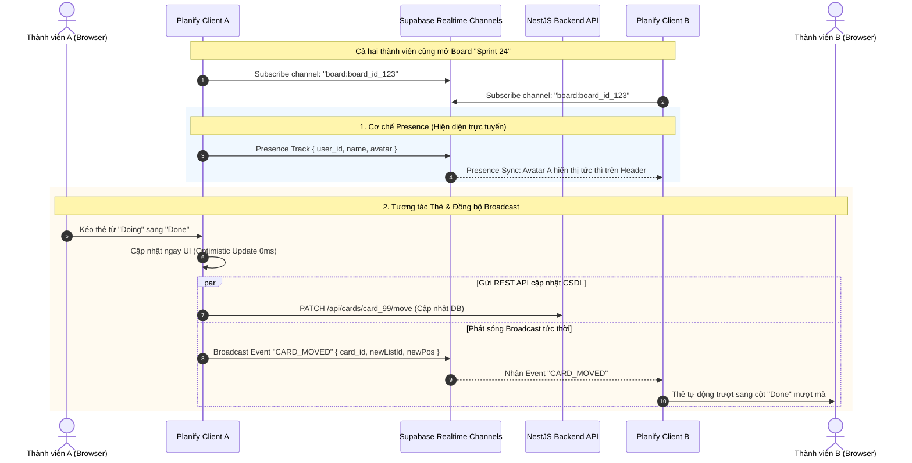
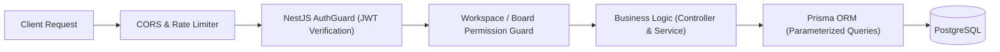
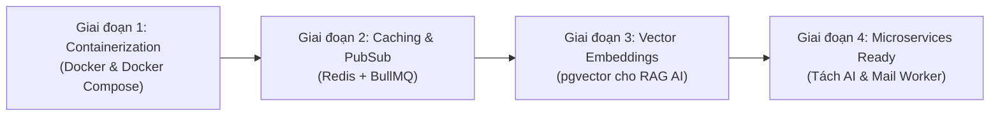

# BÁO CÁO PHÂN TÍCH TOÀN DIỆN CÔNG NGHỆ HỆ THỐNG PLANIFY
**Tài liệu Kỹ thuật Kiến trúc Phần mềm & Danh mục Công nghệ (Technical Architecture & Technology Stack Specification)**

---

## MỤC LỤC
1. [TỔNG QUAN KIẾN TRÚC HỆ THỐNG (SYSTEM ARCHITECTURE OVERVIEW)](#1-tổng-quan-kiến-trúc-hệ-thống-system-architecture-overview)
2. [CÔNG NGHỆ TẦNG TRÌNH DIỄN (FRONTEND TIER)](#2-công-nghệ-tầng-trình-diễn-frontend-tier)
3. [CÔNG NGHỆ TẦNG DỊCH VỤ & NGHIỆP VỤ (BACKEND TIER)](#3-công-nghệ-tầng-dịch-vụ--nghiệp-vụ-backend-tier)
4. [CƠ SỞ DỮ LIỆU & GIAO TIẾP THỜI GIAN THỰC (DATABASE & REALTIME ENGINE)](#4-cơ-sở-dữ-liệu--giao-tiếp-thời-gian-thực-database--realtime-engine)
5. [TRÍ TUỆ NHÂN TẠO & ĐIỀU HÀNH THÔNG MINH (AI COPILOT & AUTOMATIONS)](#5-trí-tuệ-nhân-tạo--điều-hành-thông-minh-ai-copilot--automations)
6. [HỆ THỐNG BẢO MẬT, XÁC THỰC & PHÂN QUYỀN (SECURITY & AUTHENTICATION)](#6-hệ-thống-bảo-mật-xác-thực--phân-quyền-security--authentication)
7. [ĐÁNH GIÁ ĐIỂM MẠNH, HẠN CHẾ & LỘ TRÌNH MỞ RỘNG (EVALUATION & ROADMAP)](#7-đánh-giá-điểm-mạnh-hạn-chế--lộ-trình-mở-rộng-evaluation--roadmap)
8. [BẢNG TỔNG HỢP DANH MỤC CÔNG NGHỆ & PHIÊN BẢN (TECH SPECIFICATIONS MATRIX)](#8-bảng-tổng-hợp-danh-mục-công-nghệ--phiên-bản-tech-specifications-matrix)

---

## 1. TỔNG QUAN KIẾN TRÚC HỆ THỐNG (SYSTEM ARCHITECTURE OVERVIEW)

Planify là nền tảng quản lý công việc và dự án Kanban thế hệ mới, ứng dụng mô hình cộng tác đa người dùng theo thời gian thực (Realtime Collaborative Work Management Platform). Hệ thống được xây dựng theo kiến trúc **Client-Server 3 tầng (3-Tier Decoupled Architecture)** được chuẩn hóa trong cấu trúc Monorepo thống nhất:

```mermaid
flowchart TB
    subgraph ClientLayer ["1. Presentation Layer (Frontend)"]
        Browser["Trình duyệt Client (Web App)"]
        NextJS["Next.js 16.3.1 (App Router + Turbopack)"]
        React19["React 19.2.8 + TypeScript 5"]
        TailwindCSS["Tailwind CSS v4 + Dynamic Theme Engine"]
        OptimisticUI["Optimistic UI (0ms DragSaveQueue)"]
        Browser --> NextJS
        NextJS --> React19
        React19 --> TailwindCSS
        React19 --> OptimisticUI
    end

    subgraph GatewayLayer ["Network & Gateway"]
        ReverseProxy["Reverse Proxy / HTTPS Gateway"]
        NextJS -->|REST API Calls (JSON)| ReverseProxy
        NextJS -.->|Realtime WebSocket (Presence & Broadcast)| SupabaseRealtime
    end

    subgraph ServiceLayer ["2. Application & Business Logic Layer (Backend)"]
        ReverseProxy --> NestJSApp["NestJS 11.0.1 Core Engine"]
        NestJSApp --> AuthModule["Auth & Security (JWT, Bcrypt, Google OAuth, Native SMTP OTP)"]
        NestJSApp --> BoardModule["Board & Card Kanban Operations"]
        NestJSApp --> AutoEngine["Automations Engine (Triggers & Actions)"]
        NestJSApp --> AIModule["AI Copilot & Standup Engine (@google/genai)"]
        NestJSApp --> ImportExport["Import/Export Engine (XLSX, CSV, Trello)"]
    end

    subgraph ThirdPartyAI ["External AI Services"]
        GoogleGemini["Google Gemini 2.0 Flash / Pro (Google AI Studio)"]
        AIModule <-->|Secure SDK Calls| GoogleGemini
    end

    subgraph DataPersistenceLayer ["3. Data & Realtime Persistence Layer"]
        PrismaORM["Prisma ORM 6.4.1 (Type-Safe Client)"]
        NestJSApp --> PrismaORM
        PostgresDB[("PostgreSQL Database (Supabase Managed)")]
        PrismaORM -->|Pooled / Direct Connection| PostgresDB
        SupabaseRealtime["Supabase Realtime Server (Elixir/Phoenix Channels)"]
        PostgresDB <-->|WAL / Logical Replication| SupabaseRealtime
    end
```

### Nguyên tắc Kiến trúc Chủ đạo:
1. **API-First & Loose Coupling**: Tầng Frontend và Backend phân tách độc lập hoàn toàn. Mọi tương tác nghiệp vụ đều thông qua chuẩn RESTful API với tài liệu OpenAPI/Swagger đồng bộ.
2. **Zero-Latency Interaction (Optimistic UI)**: Các thao tác tương tác thường xuyên (kéo thả thẻ, checklist, đánh dấu hoàn thành) được cập nhật ngay lập tức trên UI với độ trễ 0ms, sau đó đồng bộ ngầm qua hàng đợi bất đồng bộ.
3. **Dual-Channel Realtime Collaboration**: Sử dụng kênh Broadcast cho cập nhật dữ liệu thẻ/bảng và kênh Presence để phản ánh tức thời trạng thái hiển thị của các thành viên đang cùng làm việc.
4. **AI-Assisted Workflow**: Trí tuệ nhân tạo (Google Gemini) được tích hợp trực tiếp vào quy trình làm việc thường nhật (phân rã thẻ việc, quét rủi ro, tạo báo cáo Daily Standup, trợ lý đàm thoại Copilot).

---

## 2. CÔNG NGHỆ TẦNG TRÌNH DIỄN (FRONTEND TIER)

Tầng Frontend chịu trách nhiệm về giao diện, trải nghiệm tương tác, phản hồi thời gian thực và khả năng tùy biến hiển thị theo thị hiếu người dùng.

### 2.1 Next.js 16.3.1 (App Router & Turbopack)
- **Phiên bản:** `16.3.1`
- **Cơ chế hoạt động:** Ứng dụng mô hình **App Router (`app/` directory)** với cơ chế kết hợp Server Components (RSC) cho các trang tĩnh/SEO và Client Components (`'use client'`) cho các bảng tương tác thời gian thực cao độ.
- **Trình biên dịch Turbopack:** Sử dụng Turbopack làm engine bundler mặc định trong môi trường phát triển, mang lại tốc độ Hot Module Replacement (HMR) tính bằng mili-giây, giảm đáng kể thời gian build so với Webpack truyền thống.
- **Tối ưu hóa Routing & Layouts:** Sử dụng Route Groups như `(auth)` để cô lập logic đăng nhập/đăng ký với cấu trúc Layout phân vùng riêng biệt mà không ảnh hưởng tới URL path.

### 2.2 React 19.2.8 & TypeScript 5
- **Phiên bản:** React `19.2.8`, TypeScript `^5`
- **Lý do lựa chọn:**
  - Hỗ trợ đầy đủ các tính năng hiện đại nhất của React 19: Action hooks, tối ưu hóa quá trình hydration, cơ chế quản lý trạng thái đồng thời (Concurrent rendering).
  - TypeScript 5 mang lại sự an toàn kiểu dữ liệu tuyệt đối (Type Safety) trên toàn bộ component tree, DTO gửi lên server và dữ liệu realtime nhận về từ Supabase.

### 2.3 Tailwind CSS v4 (`@tailwindcss/postcss`)
- **Phiên bản:** `^4.0.0`
- **Đặc tính kỹ thuật:**
  - Tailwind CSS v4 áp dụng kiến trúc engine mới viết bằng Rust, loại bỏ hoàn toàn file cấu hình cồng kềnh `tailwind.config.js`, chuyển sang cấu hình trực tiếp thông qua CSS variables và `@theme` directive trong `globals.css`.
  - Zero-runtime overhead: Toàn bộ CSS được compile tĩnh tại build-time, tối ưu kích thước bundle nhỏ nhất có thể.

### 2.4 Hệ thống Giao diện Động & Dark Mode (Dynamic Theme Engine)
- **Cơ chế triển khai:** Hệ thống tùy biến giao diện toàn diện xây dựng trên CSS Variables token-based (`frontend/lib/theme-context.tsx`, `frontend/lib/theme-utils.ts`):
  - **Dark Mode thông minh:** Hỗ trợ 3 chế độ (`light`, `dark`, `system`). Tự động phát hiện cài đặt hệ thống người dùng và lắng nghe sự kiện `prefers-color-scheme`.
  - **Thuật toán sinh bảng màu động (Palette Derivation):** Cho phép người dùng chọn màu chủ đạo (Primary Hex Color). Hệ thống tự động tính toán các dải màu hover, active, light tint (`-50`, `-100`), shadow glow và viền phù hợp.
  - **Tự động cân bằng độ tương phản WCAG AA:** Thuật toán tính độ sáng tương đối (Relative Luminance) tự động đảo màu chữ giữa `#ffffff` và `#0f172a` trên nền nút/badge, đảm bảo khả năng tiếp cận tối đa cho người khiếm thị.

### 2.5 Cơ chế Tối ưu Kéo Thả 0ms Latency (Optimistic UI & `DragSaveQueue`)
- **Vấn đề giải quyết:** Kéo thả thẻ Kanban trong môi trường mạng thông thường dễ gây cảm giác "giật / khựng" do phải chờ HTTP request phản hồi từ backend.
- **Giải pháp kỹ thuật (`frontend/lib/drag-save-queue.ts`):**
  - **Optimistic State Mutation:** Cập nhật vị trí thẻ trong React State ngay khi chuột thả thẻ (0ms delay).
  - **Microtask Queue Batching:** Ứng dụng API trình duyệt chuẩn `queueMicrotask(() => void this.drain())`. Khi người dùng kéo thả liên tục nhiều thẻ, các lệnh cập nhật được gom nhóm trong cùng một tick của Event Loop, loại bỏ tình trạng spam API lên server.
  - **Tự động phục hồi lỗi (Error Rollback):** Nếu mạng ngắt quãng, hàng đợi tự động tạm dừng (`paused`), bảo toàn thứ tự tác vụ và thông báo lỗi minh bạch cho người dùng thay vì làm hỏng dữ liệu.

### 2.6 Hệ thống Visual Playful Doodles & Iconography
- **Thư viện Icon:** `lucide-react` (v1.46.0) cung cấp hơn 1,000 icon vector hiện đại, sắc nét.
- **Hệ thống Doodle Vector độc quyền (`DoodleIcons.tsx`):** Bộ 12 linh vật và biểu tượng vẽ tay phong cách Playful Engineering (Tên lửa, Ngôi sao may mắn, Mục tiêu phi tiêu, Giọt cà phê, Cây bút ý tưởng, Checkbox thành công,...) trang bị hiệu ứng chuyển động lơ lửng (Floating Keyframe Animations) và màu sắc sinh động, biến các màn hình Landing Page, Login, Register thành trải nghiệm trực quan thu hút.

### 2.7 Xử lý Tệp Ngoại vi: SheetJS (`xlsx`)
- **Phiên bản:** `^0.18.5`
- **Ứng dụng:** Trích xuất và nạp dữ liệu bảng Kanban trực tiếp ở trình duyệt sang các định dạng bảng tính thông dụng (.xlsx, .csv) mà không bắt buộc phải đẩy tải xử lý tệp lớn về cho server.

---

## 3. CÔNG NGHỆ TẦNG DỊCH VỤ & NGHIỆP VỤ (BACKEND TIER)

Tầng Backend được thiết kế theo chuẩn Enterprise Node.js, đảm nhiệm logic nghiệp vụ phức tạp, phân quyền bảo mật, xác thực danh tính, vận hành luật tự động hóa và tích hợp trí tuệ nhân tạo.

### 3.1 NestJS 11.0.1 (Enterprise Node.js Framework)
- **Phiên bản:** `@nestjs/core` & `@nestjs/common` `11.0.1`
- **Mô hình kiến trúc:** Ứng dụng mẫu thiết kế hướng Module (Modular Architecture) chặt chẽ kết hợp nguyên lý **Inversion of Control (IoC)** và **Dependency Injection (DI)**.
- **Hệ thống Phân tầng (Lifecycle Architecture):**
  - **Guards:** Kiểm tra tính hợp lệ của JWT Token và phân quyền thành viên theo Role (Owner, Admin, Member, Observer) trước khi vào Controller.
  - **Interceptors:** Ghi nhật ký hoạt động (Audit Trail logging), đo lường thời gian thực thi request.
  - **Pipes:** Tiêu chuẩn hóa dữ liệu đầu vào thông qua `ValidationPipe` tích hợp sẵn.
  - **Exception Filters:** Chuẩn hóa toàn bộ cấu trúc lỗi JSON trả về cho Client.

### 3.2 Danh mục 21 Module Nghiệp vụ Độc lập
Hệ thống backend được phân rã thành 21 module chuyên biệt, đảm bảo khả năng bảo trì và kiểm thử độc lập:
1. `auth`: Đăng ký, đăng nhập, cấp phát JWT, xác thực Google OAuth, xử lý OTP.
2. `users`: Quản lý hồ sơ, ảnh đại diện, trạng thái làm việc (Work Status), liên kết mạng xã hội.
3. `workspaces`: Quản lý tổ chức, thành viên, lời mời và quyền hạn cấp không gian.
4. `boards`: Quản lý bảng Kanban, chế độ tham gia (Public/Private/Invite-only), gắn sao, template.
5. `lists`: Danh sách cột Kanban, sắp xếp vị trí thứ tự, giới hạn số lượng công việc (WIP Limits).
6. `cards`: Quản lý thẻ công việc chi tiết, hạn hoàn thành, màu bìa (Cover), trạng thái hoàn thành.
7. `card-relations`: Quản lý quan hệ phụ thuộc giữa các thẻ (Blocking, Blocked-by, Relates-to).
8. `checklists`: Danh sách kiểm tra con trong từng thẻ, tỷ lệ % hoàn thành tiến độ.
9. `comments`: Trao đổi thảo luận trong thẻ, cơ chế tag thành viên (@mention).
10. `attachments`: Quản lý tệp đính kèm tài liệu, ảnh cho công việc.
11. `labels`: Hệ thống nhãn dán phân loại thẻ theo màu sắc và ngữ cảnh.
12. `custom-fields`: Trường thông tin tự định nghĩa linh hoạt (Văn bản, Số, Ngày tháng, Dropdown, Checkbox).
13. `activities`: Ghi lại nhật ký kiểm toán (Audit Trail) chi tiết từng thay đổi trên toàn bộ hệ thống.
14. `notifications`: Hệ thống thông báo thông minh trong ứng dụng (In-app notifications).
15. `search`: Bộ máy tìm kiếm toàn cục đa tiêu chí trên thẻ, danh sách, bảng và workspace.
16. `templates`: Quản lý kho mẫu bảng dự án định hình sẵn (Agile Sprint, Marketing, Personal CRM).
17. `automations`: Động cơ thực thi luật tự động hóa không cần code (No-code Automation Engine).
18. `ai`: Dịch vụ điều hành trí tuệ nhân tạo tích hợp Google Gemini API.
19. `analytics`: Thống kê tiến độ bảng, biểu đồ hoàn thành, báo cáo năng suất làm việc.
20. `import-export`: Nhập xuất dữ liệu Kanban từ Excel, CSV, JSON và Trello boards.
21. `mail`: Động cơ gửi thư điện tử thuần (Native SMTP Engine) bảo mật cao.

### 3.3 Prisma ORM 6.4.1 (Next-Generation Data Layer)
- **Phiên bản:** `@prisma/client` và `prisma` `^6.4.1`
- **Đặc tính kỹ thuật:**
  - **Type-safe Query Builder:** Tự động sinh TypeScript interfaces từ Schema, loại bỏ hoàn toàn các lỗi sai chính tả tên cột hoặc sai kiểu dữ liệu thời điểm viết code.
  - **Connection Pooling & Direct URL:** Cấu hình kép tối ưu: `DATABASE_URL` (kết nối qua PgBouncer connection pooler) phục vụ tải cao và `DIRECT_URL` (kết nối trực tiếp PostgreSQL) phục vụ chạy Migration schema an toàn.
  - **Quan hệ CSDL toàn vẹn:** Khai báo khóa ngoại chặt chẽ với cơ chế `onDelete: Cascade` trên các quan hệ phụ thuộc (List -> Card -> Checklist/Comment/Attachment).

### 3.4 Swagger / OpenAPI 3.0 (`@nestjs/swagger`)
- **Phiên bản:** `@nestjs/swagger` `^11.4.7`, `swagger-ui-express` `^5.0.1`
- **Địa chỉ truy cập:** `/api/docs`
- **Khả năng:** Tự động tạo giao diện thử nghiệm API trực quan, đầy đủ Schema DTO, tài liệu hóa các endpoint, yêu cầu Bearer Auth và mã phản hồi HTTP (200, 201, 400, 401, 403, 404, 500).

### 3.5 Động cơ Gửi Mail Thuần (Native SMTP Engine - Zero External Dependencies)
- **Tệp mã nguồn:** `backend/src/modules/mail/mail.service.ts`
- **Đặc điểm kiến trúc độc đáo:**
  - Hệ thống **không phụ thuộc** vào các thư viện bên thứ ba nặng nề như Nodemailer.
  - Được lập trình trực tiếp bằng socket mạng tầng thấp của Node.js: `node:net` và `node:tls`.
  - Thực thi tuần tự giao thức SMTP chuẩn quốc tế (RFC 5321 / RFC 821): bắt tay `EHLO/HELO`, nâng cấp bảo mật mã hóa đường truyền `STARTTLS`, xác thực tài khoản `AUTH LOGIN`, thiết lập người gửi/nhận `MAIL FROM` & `RCPT TO`, truyền tải nội dung `DATA` chuẩn MIME HTML/UTF-8 và ngắt kết nối `QUIT`.
  - Giúp gửi mã xác minh 6 số (OTP) cho quy trình Đăng ký và Quên mật khẩu với tốc độ cực nhanh, kích thước gói phần mềm nhẹ và tính ổn định cao.

### 3.6 Data Transfer Object & Validation
- **Thư viện:** `class-validator` (v0.15.1) và `class-transformer` (v0.5.1)
- **Tính năng:** Đảm bảo toàn bộ payload gửi từ client đều được sanitize, chuyển đổi kiểu dữ liệu chính xác (Whitelisting), tự động loại bỏ các thuộc tính không hợp lệ và trả về thông báo lỗi chuẩn hóa.

---

## 4. CƠ SỞ DỮ LIỆU & GIAO TIẾP THỜI GIAN THỰC (DATABASE & REALTIME ENGINE)

Hệ thống lưu trữ và đồng bộ dữ liệu thời gian thực được xây dựng trên nền tảng **PostgreSQL** kết hợp giải pháp **Supabase Realtime Engine**.

### 4.1 Cơ sở Dữ liệu Quan hệ PostgreSQL
- **Hệ quản trị CSDL:** PostgreSQL 15+ (Hosted trên hạ tầng Supabase).
- **Chuẩn hóa dữ liệu:** Thiết kế tuân thủ chuẩn 3NF (Third Normal Form) kết hợp các cột kiểu `Json` (PostgreSQL JSONB) cho các trường linh động cao như `social_links`, cấu hình kích hoạt `trigger_config`, danh sách `conditions` và `actions` của luật tự động.
- **Quy mô Schema:** Hệ thống định nghĩa 25 bảng thực thể chính:
  1. `User`: Tài khoản, thông tin cá nhân, avatar, trạng thái làm việc.
  2. `Workspace`: Không gian làm việc nhóm.
  3. `WorkspaceMember`: Phân quyền thành viên trong Workspace (Owner, Admin, Member, Observer).
  4. `WorkspaceInvite`: Mã mời tham gia không gian làm việc kèm thời hạn.
  5. `Notification`: Thông báo hệ thống gửi đến người dùng.
  6. `ActivityLog`: Bản ghi kiểm toán chi tiết lịch sử thao tác.
  7. `Board`: Bảng làm việc Kanban, quyền riêng tư, cấu hình join mode.
  8. `BoardMember`: Vai trò thành viên trong từng bảng cụ thể.
  9. `BoardEditorRequest`: Hàng đợi phê duyệt quyền chỉnh sửa bảng.
  10. `List`: Danh sách / Cột Kanban (Backlog, In Progress, Review, Done,...).
  11. `Card`: Thẻ công việc chi tiết.
  12. `CardAssignee`: Quan hệ phân công công việc đa thành viên.
  13. `Label`: Nhãn phân loại trực quan theo màu sắc.
  14. `CardLabel`: Bảng liên kết thẻ và nhãn dán.
  15. `Checklist`: Bảng kiểm tra tiến độ trong thẻ.
  16. `ChecklistItem`: Hạng mục công việc con cần tích chọn.
  17. `Comment`: Bình luận, phản hồi và thảo luận của các thành viên.
  18. `Attachment`: Tệp đính kèm liên kết với thẻ công việc.
  19. `CardRelation`: Mối quan hệ liên kết và phụ thuộc giữa các thẻ.
  20. `CustomField`: Định nghĩa trường tùy chỉnh do người dùng tạo.
  21. `CustomFieldValue`: Giá trị thực tế của trường tùy chỉnh trên từng thẻ.
  22. `AutomationRule`: Bản ghi quy tắc tự động hóa.
  23. `AutomationTrigger`: Điều kiện kích hoạt luật tự động.
  24. `AutomationAction`: Hành động thực thi của luật tự động.
  25. `AuthOtp`: Mã OTP 6 chữ số kèm thời hạn hết hạn phục vụ đăng ký và quên mật khẩu.

### 4.2 Cơ chế Đồng bộ Thời gian thực (Supabase Realtime v2 Engine)
Khác với mô hình Polling gây lãng phí băng thông và chậm trễ, Planify sử dụng cơ chế WebSocket dựa trên engine Phoenix Channels của Elixir:



- **Kênh Realtime Broadcast (`broadcast`):**
  - Khi một người dùng thực hiện kéo thả thẻ, chỉnh sửa tiêu đề, đổi nhãn hoặc tích checklist, sự kiện được phát sóng tức thì tới toàn bộ các client đang theo dõi cùng ID bảng.
  - Độ trễ truyền tin trung bình dưới 50ms, tạo cảm giác cộng tác tức thời như Google Docs hay Figma.
- **Giao thức Hiện diện Trực tuyến (`presence`):**
  - Tự động phát hiện khi có thành viên mới truy cập vào bảng hoặc rời đi (kể cả khi mất kết nối đột ngột hay đóng tab).
  - Hiển thị danh sách Avatar có viền xanh Online trên thanh công cụ Header bảng Kanban theo thời gian thực.

---

## 5. TRÍ TUỆ NHÂN TẠO & ĐIỀU HÀNH THÔNG MINH (AI COPILOT & AUTOMATIONS)

Planify tích hợp sâu các mô hình trí tuệ nhân tạo tạo sinh (Generative AI) thế hệ mới nhất của Google cùng động cơ luật tự động hóa doanh nghiệp.

### 5.1 Google Gemini 2.0 SDK (`@google/genai` v2.24.0)
- **Thư viện chính thức:** Sử dụng bộ SDK mới nhất của Google (`@google/genai`) hỗ trợ các mô hình nền tảng Gemini 2.0 Flash / Pro.
- **Cơ chế nạp API Key an toàn:** Backend sở hữu thuật toán đa tầng (`resolveApiKey`), tự động tìm nạp `GEMINI_API_KEY` từ biến môi trường của hệ điều hành, file `.env` cục bộ và các thư mục cha, đảm bảo không bị gián đoạn hoạt động khi triển khai lên môi trường Production.

### 5.2 Các Tính năng AI Đột phá trong Hệ thống
1. **AI Board Copilot (Trợ lý Đàm thoại Toàn cảnh Bảng):**
   - Áp dụng kỹ thuật nạp ngữ cảnh động (Dynamic Context Augmentation). Khi người dùng đặt câu hỏi, hệ thống tự động tổng hợp toàn bộ danh sách thẻ, tiến độ, nhãn dán, thành viên phụ trách và lịch sử hoạt động thành một bản chụp ngữ cảnh (Context Snapshot) gửi kèm vào Prompt.
   - Cho phép trả lời các câu hỏi phức tạp: *"Ai đang phụ trách nhiều task nhất?", "Tuần này những công việc nào có nguy cơ trễ hạn?", "Tóm tắt tiến độ tính năng thanh toán."*
2. **AI Task Breakdown (Tự động Phân rã Công việc):**
   - Tiếp nhận tiêu đề và mô tả ngắn của một công việc phức tạp (Ví dụ: *"Xây dựng tính năng Đăng nhập bằng Google"*).
   - Gemini AI tự động suy luận logic, phân rã công việc thành danh sách các bước hành động cụ thể, khả thi và trả về định dạng JSON có cấu trúc để nạp thẳng vào Checklist của thẻ.
3. **AI Daily Standup Generator (Báo cáo Cuộc họp Hàng ngày Tự động):**
   - Quét toàn bộ Activity Log và tình trạng thẻ trong 24 giờ qua.
   - Tự động biên soạn báo cáo chuẩn Agile Scrum theo 3 câu hỏi kinh điển:
     - Hôm qua cả đội đã hoàn thành những gì?
     - Hôm nay kế hoạch tiếp theo là gì?
     - Đang có những điểm nghẽn (Blockers) hoặc trở ngại nào cần tháo gỡ?
4. **AI Risk & Bottleneck Scanner (Quét Rủi ro & Điểm nghẽn Dự án):**
   - Sử dụng mô hình phân tích dự báo để rà soát:
     - Các thẻ gần đến hạn hoặc quá hạn chưa chuyển trạng thái.
     - Hiện tượng dồn ứ công việc vào một cá nhân (Workload overload).
     - Đưa ra đề xuất hành động cụ thể cho Quản lý dự án (Project Manager).

### 5.3 Động cơ Luật Tự động hóa Doanh nghiệp (Planify Automations Engine)
- **Tệp mã nguồn:** `backend/src/modules/automations/automations.service.ts`
- **Kiến trúc hướng sự kiện (Event-driven Architecture):**
  - **5 Loại Trigger Kích hoạt:**
    - `RULE`: Khi thẻ được tạo mới, di chuyển sang cột khác, hoặc đánh dấu hoàn thành.
    - `SCHEDULED`: Kích hoạt định kỳ theo chu kỳ thời gian định sẵn.
    - `DUE_DATE`: Kích hoạt trước ngày đáo hạn (ví dụ: trước 24 giờ).
    - `CARD_BUTTON`: Nút bấm tùy chỉnh gắn trên từng thẻ để thực thi tác vụ nhanh.
    - `BOARD_BUTTON`: Nút bấm điều khiển chung trên thanh công cụ của Bảng.
  - **Bộ Lọc Điều kiện (Conditions Engine):** Hỗ trợ so sánh trường (`equals`, `not_equals`, `contains`) đối với nhãn dán, người phụ trách, cột chứa,...
  - **Chuỗi Hành động (Action Chains):** Tự động di chuyển thẻ, thêm nhãn, gán thành viên, tạo checklist mẫu, gửi thông báo hoặc ghi log kiểm toán.

---

## 6. HỆ THỐNG BẢO MẬT, XÁC THỰC & PHÂN QUYỀN (SECURITY & AUTHENTICATION)

Bảo mật là tiêu chí trọng tâm được kiểm soát đa lớp từ giao diện tới tầng lưu trữ.



### 6.1 Cơ chế Xác thực Danh tính (Authentication)
- **JWT (JSON Web Token):** Sử dụng `@nestjs/jwt` và `passport-jwt` với thuật toán mã hóa đối xứng an toàn. Cấp phát Token chứa thông tin định danh và thời hạn hiệu lực, kiểm soát trạng thái đăng nhập dạng Stateless.
- **Bcrypt (Password Hashing):** Sử dụng thư viện `bcrypt` (v6.0.0) với Salt Rounds đạt chuẩn công nghiệp, bảo đảm mật khẩu không thể bị dịch ngược kể cả trong trường hợp CSDL bị rò rỉ.
- **Google OAuth 2.0 Integration:** Hỗ trợ đăng nhập một chạm (One-tap Sign-in) bằng Google Identity Services. Backend trực tiếp giải mã và kiểm tra tính hợp lệ của Google ID Token với Google API trước khi kích hoạt phiên đăng nhập.
- **Mã Xác minh 2 Bước OTP (One-Time Password):**
  - Mã 6 số ngẫu nhiên sinh từ hàm mật mã học an toàn, lưu trữ trong bảng `AuthOtp`.
  - Giới hạn thời gian hiệu lực nghiêm ngặt (10 phút), tự động hủy sau khi sử dụng thành công, chống tấn công Brute-force và Replay attacks.

### 6.2 Hệ thống Phân quyền Đa tầng (Role-Based Access Control - RBAC)
- **Cấp Workspace (Không gian làm việc):**
  - `OWNER`: Toàn quyền quản trị, xóa workspace, chuyển quyền sở hữu, quản lý thanh toán.
  - `ADMIN`: Quản lý thành viên, tạo/xóa bảng trong workspace, cấu hình chung.
  - `MEMBER`: Tham gia các bảng được phân công, tạo bảng mới, cộng tác thông thường.
  - `OBSERVER`: Chỉ có quyền xem tài liệu và tiến độ, không được chỉnh sửa thẻ.
- **Cấp Board (Bảng Kanban):**
  - Phân tách vai trò Quản trị viên bảng (Board Admin) và Thành viên bảng.
  - Hỗ trợ chế độ tham gia linh hoạt (`join_mode`): Mở tự do cho toàn workspace, yêu cầu mã mời, hoặc cần Quản trị viên phê duyệt yêu cầu biên tập (`BoardEditorRequest`).

### 6.3 Phòng chống Các Lỗ hổng Phổ biến (OWASP Top 10 Mitigation)
- **SQL Injection:** Loại bỏ triệt để do 100% câu truy vấn được xử lý qua Prisma ORM với cơ chế Parameterized Queries chuẩn hóa.
- **Cross-Site Scripting (XSS):** React 19 tự động escape toàn bộ nội dung hiển thị trong JSX; các trường văn bản giàu (Rich Text) được làm sạch trước khi nạp vào DOM.
- **Broken Object Level Authorization (BOLA):** Mọi service thao tác với Thẻ hay Bảng đều bắt buộc kiểm tra quyền sở hữu (`assertBoardWritable`, `verifyCardAccess`, `verifyBoardAccess`) trước khi thực hiện ghi dữ liệu.

---

## 7. ĐÁNH GIÁ ĐIỂM MẠNH, HẠN CHẾ & LỘ TRÌNH MỞ RỘNG (EVALUATION & ROADMAP)

### 7.1 Ma trận Đánh giá Điểm mạnh Vượt trội (Key Strengths)

| Tiêu chí | Giải pháp của Planify | Ưu điểm thực tiễn |
| :--- | :--- | :--- |
| **Tốc độ phản hồi giao diện** | Optimistic UI + `DragSaveQueue` (microtask) | Cảm giác tương tác kéo thả 0ms, không độ trễ mạng. |
| **Cộng tác nhóm** | Realtime Broadcast + Presence 2 kênh | Thấy đồng đội đang online và thẻ nhảy vị trí tức thì. |
| **Trợ lực Thông minh** | Google Gemini 2.0 AI SDK tích hợp sâu | Giảm 70% thời gian tạo task, viết standup và phát hiện rủi ro. |
| **Trải nghiệm Thị giác** | Playful Doodles + Dynamic Theme Engine | Giao diện thân thiện, sinh động, chuẩn Dark Mode WCAG AA. |
| **Gửi Mail Xác thực** | Native SMTP Socket Engine | Nhẹ, gửi OTP tức thời, không phụ thuộc thư viện cồng kềnh. |
| **Độ tin cậy mã nguồn** | 100% TypeScript + Prisma ORM + NestJS | Hệ thống chặt chẽ, dễ tái cấu trúc và mở rộng quy mô. |

### 7.2 Hạn chế Hiện tại & Thách thức Kỹ thuật (Technical Limitations)
1. **Bộ nhớ đệm (Caching Layer):** Hiện tại hệ thống chưa tích hợp Redis làm In-Memory Cache độc lập; các truy vấn dashboard nặng vẫn đọc trực tiếp từ PostgreSQL.
2. **Quota Giới hạn AI:** Khi số lượng thẻ trong bảng vượt quá hàng nghìn thẻ, việc nhồi toàn bộ bảng vào Context của Gemini có thể tiêu tốn Token và làm tăng thời gian phản hồi của AI Copilot.
3. **Môi trường Đóng gói (Containerization):** Chưa có cấu hình `Dockerfile` và `docker-compose.yml` tiêu chuẩn để triển khai môi trường Full-stack bằng một câu lệnh duy nhất.

### 7.3 Lộ trình Mở rộng Đề xuất (Scalability Roadmap)



1. **Giai đoạn 1 - Đóng gói Container (Dockerization):**
   - Xây dựng Multi-stage Dockerfile cho Next.js Frontend (chế độ `standalone` tối ưu dung lượng dưới 100MB).
   - Đóng gói NestJS Backend và Prisma Client chạy ổn định trên mọi nền tảng điện toán đám mây (AWS ECS, Google Cloud Run, DigitalOcean).
2. **Giai đoạn 2 - Bổ sung Redis & Hàng đợi Nhiệm vụ (BullMQ):**
   - Triển khai Redis In-Memory Cache cho các endpoint đọc nhiều dữ liệu (`/boards/:id`, `/analytics`).
   - Sử dụng BullMQ xử lý tác vụ nền: Gửi email OTP hàng loạt, quét rủi ro dự án định kỳ mà không chiếm dụng CPU của main thread.
3. **Giai đoạn 3 - Tối ưu hóa RAG AI với Vector Search (`pgvector`):**
   - Tích hợp extension `pgvector` vào PostgreSQL để lưu trữ Embeddings của từng công việc và bình luận.
   - Khi hỏi AI Copilot, chỉ tìm kiếm ngữ nghĩa các thẻ liên quan nhất thay vì nạp toàn bộ bảng, giúp tiết kiệm 80% chi phí Token và tăng tốc độ trả lời gấp 3 lần.
4. **Giai đoạn 4 - Tự động hóa Quy trình Kiểm thử & Triển khai (CI/CD):**
   - Thiết lập GitHub Actions tự động chạy `eslint`, `prisma validate`, `jest unit test` và kiểm thử giao diện `playwright` trước khi merge vào nhánh `main`.

---

## 8. BẢNG TỔNG HỢP DANH MỤC CÔNG NGHỆ & PHIÊN BẢN (TECH SPECIFICATIONS MATRIX)

### 8.1 Frontend Technology Stack
| Phân loại | Tên Công nghệ / Thư viện | Phiên bản | Mục đích & Vai trò trong Planify |
| :--- | :--- | :--- | :--- |
| **Framework** | Next.js (App Router) | `16.3.1` | Core Framework, Server-Side Rendering & Client Routing |
| **UI Library** | React / React DOM | `19.2.8` | Xây dựng cây thành phần giao diện người dùng |
| **Ngôn ngữ** | TypeScript | `^5.0.0` | Đảm bảo tính an toàn kiểu dữ liệu tĩnh |
| **CSS Engine** | Tailwind CSS / PostCSS | `^4.0.0` | Tiện ích định kiểu giao diện hiện đại không runtime overhead |
| **Biểu tượng** | Lucide React | `^1.46.0` | Bộ icon vector trực quan cho các nút bấm và thanh điều hướng |
| **Realtime Client** | `@supabase/supabase-js` | `^2.116.0` | Kết nối WebSocket Realtime Broadcast & Presence |
| **Xử lý Bảng tính** | SheetJS (`xlsx`) | `^0.18.5` | Đọc, trích xuất và nạp dữ liệu Excel/CSV tại Client |
| **Quản lý Theme** | Custom CSS Variables Engine | Built-in | Chuyển đổi Dark Mode và tùy biến màu sắc thương hiệu |
| **Tối ưu Kéo thả** | `DragSaveQueue` Engine | Built-in | Hàng đợi microtask khử trễ, hỗ trợ kéo thả 0ms Optimistic |

### 8.2 Backend Technology Stack
| Phân loại | Tên Công nghệ / Thư viện | Phiên bản | Mục đích & Vai trò trong Planify |
| :--- | :--- | :--- | :--- |
| **Framework** | NestJS Core & Common | `11.0.1` | Khung ứng dụng Enterprise Node.js hướng module |
| **Platform** | Express Platform | `11.0.1` | HTTP Web Server engine |
| **Cơ sở dữ liệu ORM** | Prisma Client & CLI | `6.4.1` | Quản trị Schema, quan hệ bảng và truy vấn CSDL an toàn |
| **API Documentation**| `@nestjs/swagger` | `11.4.7` | Tự động sinh tài liệu chuẩn tương tác OpenAPI 3.0 |
| **Swagger UI** | `swagger-ui-express` | `5.0.1` | Giao diện đồ họa tra cứu và thử nghiệm API tại `/api/docs` |
| **Trí tuệ Nhân tạo** | `@google/genai` | `2.24.0` | Tích hợp Google Gemini 2.0 (Copilot, Standup, Breakdown) |
| **Xác thực Token** | `@nestjs/jwt` & `passport-jwt` | `11.0.0` / `4.0.1` | Cấp phát và giải mã xác thực phiên người dùng qua JWT |
| **Băm Mật khẩu** | `bcrypt` | `6.0.0` | Băm mật khẩu người dùng với salt rounds an toàn |
| **Kiểm tra Payload** | `class-validator` / `transformer`| `0.15.1` / `0.5.1` | Validate dữ liệu đầu vào và chuyển đổi kiểu DTO tự động |
| **Gửi Mail OTP** | Native SMTP (`node:net`, `tls`) | Built-in | Triển khai trực tiếp giao thức SMTP RFC 5321 gửi OTP |
| **Tự động hóa** | Automations Service Engine | Built-in | Thực thi hệ thống luật, triggers và actions theo sự kiện |
| **Cấu hình Môi trường**| `@nestjs/config` | `4.0.4` | Quản lý biến môi trường `.env` đa tầng tập trung |

### 8.3 Infrastructure & Database Stack
| Thành phần | Nền tảng / Công nghệ | Vai trò & Đặc điểm kỹ thuật |
| :--- | :--- | :--- |
| **Cơ sở Dữ liệu Chính** | PostgreSQL 15+ | CSDL quan hệ chuẩn hóa 3NF, hỗ trợ JSONB, lưu trữ 25 bảng thực thể |
| **Dịch vụ Lưu trữ CSDL** | Supabase Managed Cloud | Quản trị cụm CSDL, sao lưu tự động và quản lý kết nối PgBouncer |
| **Máy chủ Realtime** | Supabase Realtime Server | Phoenix Channels (Elixir) phát tán sự kiện Broadcast & Presence |
| **Trí tuệ Nhân tạo Cloud**| Google AI Studio | Cung cấp tài nguyên tính toán mô hình ngôn ngữ lớn Gemini 2.0 |
| **Môi trường Thực thi** | Node.js v20+ / v22+ LTS | Runtime JavaScript hiệu năng cao hỗ trợ ES Modules và Native TLS |

---

## LỜI KẾT
Tài liệu trên phản ánh chính xác cấu trúc kỹ thuật và kiến trúc thực tế của hệ thống **Planify**. Nhờ sự kết hợp hài hòa giữa các công nghệ hiện đại hàng đầu (**Next.js 16**, **React 19**, **NestJS 11**, **Prisma ORM 6**, **PostgreSQL**, **Supabase Realtime** và **Google Gemini 2.0 AI**), Planify sở hữu một nền tảng vững chắc, sẵn sàng đáp ứng nhu cầu quản lý công việc linh hoạt, an toàn và có khả năng mở rộng cao trong tương lai.

