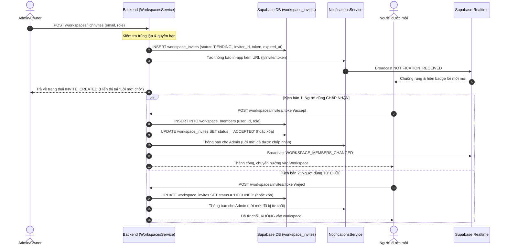

# THIẾT KẾ TÍNH NĂNG: QUY TRÌNH LỜI MỜI KHÔNG GIAN LÀM VIỆC (WORKSPACE INVITATIONS FLOW)

## 1. Tổng quan & Kiến trúc

### 1.1 Mục tiêu
Thay đổi triệt để quy trình mời thành viên vào Không gian làm việc (Workspace):
- **Tuyệt đối không mời thẳng (No Direct Add):** Khi quản trị viên mời một người dùng (dù đã có tài khoản hay chưa), hệ thống BẮT BUỘC phải tạo lời mời ở trạng thái chờ (`PENDING`).
- **Thông báo & Hiển thị:** Người được mời nhận được thông báo in-app (chuông thông báo + badge), lời mời xuất hiện trong mục "Lời mời" cá nhân và email (nếu áp dụng).
- **Quyền quyết định:** Người dùng có thể nhấn **Chấp nhận (Accept)** để chính thức trở thành thành viên Workspace, hoặc **Từ chối (Decline/Reject)** để hủy bỏ lời mời mà không vào Workspace.
- **Theo dõi tiến độ:** Quản trị viên theo dõi được danh sách lời mời đang chờ trong tab "Lời mời chờ" của Workspace và có thể thu hồi bất cứ lúc nào.

### 1.2 Kiến trúc luồng dữ liệu (State Diagram & Sequence)



---

## 2. Giao diện kết nối (Shared Contracts)

### 2.1 CSDL Supabase / PostgreSQL Migration

Bổ sung các cột cần thiết cho bảng `workspace_invites`:

```sql
-- Migration: Add missing columns to workspace_invites
ALTER TABLE workspace_invites 
  ADD COLUMN IF NOT EXISTS inviter_id UUID REFERENCES users(id) ON DELETE SET NULL,
  ADD COLUMN IF NOT EXISTS status VARCHAR(20) DEFAULT 'PENDING',
  ADD COLUMN IF NOT EXISTS created_at TIMESTAMPTZ DEFAULT NOW();

-- Chỉ mục hỗ trợ truy vấn nhanh
CREATE INDEX IF NOT EXISTS idx_workspace_invites_email_status ON workspace_invites(email, status);
CREATE INDEX IF NOT EXISTS idx_workspace_invites_ws_status ON workspace_invites(workspace_id, status);
```

Cập nhật `backend/prisma/schema.prisma`:
```prisma
model WorkspaceInvite {
  id           String    @id @default(uuid()) @db.Uuid
  workspace_id String    @db.Uuid
  inviter_id   String?   @db.Uuid
  email        String    @db.VarChar(255)
  role         String    @default("MEMBER") @db.VarChar(20)
  status       String    @default("PENDING") @db.VarChar(20)
  token        String    @unique @db.VarChar(500)
  created_at   DateTime  @default(now()) @db.Timestamptz
  expired_at   DateTime  @db.Timestamptz

  workspace    Workspace @relation(fields: [workspace_id], references: [id], onDelete: Cascade)
  inviter      User?     @relation("WorkspaceInviteInviter", fields: [inviter_id], references: [id], onDelete: SetNull)

  @@map("workspace_invites")
}
```

### 2.2 DTO & API Payloads

#### 1. Tạo lời mời: `POST /workspaces/:id/invites`
- **Request Body (`InviteMemberDto`):**
  ```typescript
  export class InviteMemberDto {
    @IsNotEmpty()
    @IsEmail()
    email: string;

    @IsOptional()
    @IsEnum(['ADMIN', 'MEMBER'])
    role?: 'ADMIN' | 'MEMBER' = 'MEMBER';

    @IsOptional()
    @IsBoolean()
    directAdd?: boolean = false;
  }
  ```
- **Response (201 Created):**
  ```json
  {
    "success": true,
    "statusCode": 201,
    "data": {
      "type": "INVITE_CREATED",
      "message": "Lời mời đã được gửi thành công và đang ở trạng thái chờ người dùng chấp thuận.",
      "invite": {
        "id": "uuid",
        "workspace_id": "uuid",
        "email": "user@example.com",
        "role": "MEMBER",
        "status": "PENDING",
        "token": "uuid-token",
        "expired_at": "2026-11-12T00:00:00.000Z"
      }
    }
  }
  ```

#### 2. Danh sách lời mời chờ của Workspace: `GET /workspaces/:id/invites`
- **Response (200 OK):**
  ```json
  {
    "success": true,
    "data": [
      {
        "id": "uuid",
        "email": "user@example.com",
        "role": "MEMBER",
        "status": "PENDING",
        "token": "token-xyz",
        "created_at": "2026-11-05T00:00:00.000Z",
        "expired_at": "2026-11-12T00:00:00.000Z",
        "inviter": {
          "id": "uuid",
          "name": "Admin Name",
          "email": "admin@planify.io",
          "avatar": "url"
        }
      }
    ]
  }
  ```

#### 3. Danh sách lời mời cá nhân: `GET /users/invitations`
- **Response (200 OK):**
  ```json
  {
    "success": true,
    "data": {
      "workspaceInvites": [
        {
          "id": "uuid",
          "role": "MEMBER",
          "token": "token-xyz",
          "expired_at": "2026-11-12T...",
          "workspace": {
            "id": "ws-id",
            "name": "Engineering Workspace",
            "description": "..."
          },
          "inviter": {
            "id": "user-id",
            "name": "Nguyễn Văn A",
            "avatar": "..."
          }
        }
      ],
      "boardInvites": [...]
    }
  }
  ```

#### 4. Chấp nhận lời mời: `POST /workspaces/invites/:token/accept`
- **Headers:** `Authorization: Bearer <token>`
- **Response (200 OK):**
  ```json
  {
    "success": true,
    "data": {
      "message": "Gia nhập Không gian làm việc thành công!",
      "workspaceId": "ws-uuid"
    }
  }
  ```

#### 5. Từ chối lời mời: `POST /workspaces/invites/:token/reject`
- **Headers:** `Authorization: Bearer <token>`
- **Response (200 OK):**
  ```json
  {
    "success": true,
    "data": {
      "message": "Đã từ chối lời mời tham gia Không gian làm việc"
    }
  }
  ```

### 2.3 Cấu trúc Thông báo (Notifications Contract)
- **Title:** `Lời mời tham gia Không gian làm việc`
- **Message format:** `${inviterName} đã mời bạn tham gia Không gian làm việc "${workspaceName}" với vai trò ${roleLabel}.||/invite/${token}`
- **Type:** `WORKSPACE_INVITE`
- **Realtime Event:** `NOTIFICATION_RECEIVED` phát trên kênh `user:${inviteeUserId}`.

---

## 3. Danh sách Workstreams chạy song song (Zero-Overlap)

```
├── Workstream 1: Backend & Database (Core Logic & APIs)
└── Workstream 2: Frontend UI & Interaction (Modals, Popovers & Pages)
```

### Workstream 1: Backend & Database (Core Logic & APIs)
- **Mục tiêu:**
  1. Chạy migration bổ sung `inviter_id`, `status`, `created_at` cho bảng `workspace_invites`.
  2. Cập nhật `workspaces.service.ts`:
     - Xóa bỏ logic tự động thêm thẳng `workspace_members` khi mời người dùng có sẵn tài khoản.
     - Luôn tạo `workspace_invites` với `status: 'PENDING'`, lưu `inviter_id: currentUserId`.
     - Gửi thông báo kèm link chuẩn `||/invite/${token}` cho người được mời (nếu đã có tài khoản).
     - Trong `acceptInvite`: Thêm vào `workspace_members`, cập nhật `status: 'ACCEPTED'`, gửi thông báo cho `inviter_id`, kích hoạt Realtime events.
     - Trong `rejectInvite`: Cập nhật `status: 'DECLINED'` (hoặc xóa), gửi thông báo cho `inviter_id`.
     - Cập nhật `getPendingInvites`: Lấy các lời mời có `status = 'PENDING'` kèm thông tin `inviter`.
  3. Cập nhật `users.service.ts`:
     - Sửa `getUserInvitations`: Truy vấn `workspace_invites` với `status = 'PENDING'` và lấy thông tin `inviter` chính xác.
- **File được phép tạo/sửa (Allowed Files):**
  - `backend/prisma/schema.prisma`
  - `backend/src/modules/workspaces/workspaces.service.ts`
  - `backend/src/modules/workspaces/workspaces.controller.ts`
  - `backend/src/modules/workspaces/dto/invite-member.dto.ts`
  - `backend/src/modules/users/users.service.ts`
- **Tiêu chí hoàn thành (DoD):**
  - Khi gọi `POST /workspaces/:id/invites`, người dùng KHÔNG bị thêm ngay vào `workspace_members`.
  - Record xuất hiện trong `workspace_invites` với `status: 'PENDING'`.
  - `GET /users/invitations` của người nhận trả về đúng lời mời kèm `inviter`.
  - Người nhận gọi `accept` thì mới xuất hiện trong `workspace_members`.
  - Người nhận gọi `reject` thì không vào `workspace_members`.

---

### Workstream 2: Frontend UI & Interaction Flow
- **Mục tiêu:**
  1. Cập nhật modal mời `frontend/components/modals/InviteMemberModal.tsx`:
     - Bỏ cờ `directAdd: true`, chỉ gửi `{ email, role }`.
     - Cập nhật text mô tả chuẩn: "Lời mời sẽ được chuyển vào danh sách chờ và gửi thông báo tới người dùng."
     - Cập nhật thông báo sau khi gửi thành công.
  2. Cập nhật trang quản lý Workspace `frontend/app/workspaces/[workspaceId]/page.tsx`:
     - Sub-tab "Lời mời chờ": Hiển thị người gửi lời mời (`inv.inviter?.name`), email, vai trò dự kiến, ngày hết hạn.
     - Nút "Chép link mời" và "Thu hồi lời mời".
     - Lắng nghe sự kiện `WORKSPACE_MEMBERS_CHANGED` để tự động làm mới cả danh sách thành viên và danh sách lời mời chờ.
  3. Cập nhật Modal cá nhân `frontend/components/modals/ProfileModal.tsx`:
     - Tab "Lời mời": Hiển thị tên người mời chính xác (`inv.inviter?.name`), tên Workspace, vai trò.
     - Kiểm tra nút "Chấp nhận" (`handleAcceptWorkspace`) và "Từ chối" (`handleRejectWorkspace`) hoạt động mượt mà, tự động cập nhật danh sách và badge đếm.
  4. Cập nhật trang chấp nhận lời mời `frontend/app/invite/[token]/page.tsx`:
     - Hiển thị tên người gửi lời mời và vai trò được gán.
     - Nút Chấp nhận -> điều hướng vào `/workspaces/:workspaceId`.
     - Nút Từ chối -> thông báo đã từ chối thành công, có nút về Dashboard.
  5. Cập nhật Popover thông báo `frontend/components/notifications/NotificationPopover.tsx`:
     - Đảm bảo click vào thông báo `WORKSPACE_INVITE` sẽ điều hướng chính xác đến `/invite/:token`.
- **File được phép tạo/sửa (Allowed Files):**
  - `frontend/components/modals/InviteMemberModal.tsx`
  - `frontend/app/workspaces/[workspaceId]/page.tsx`
  - `frontend/components/modals/ProfileModal.tsx`
  - `frontend/app/invite/[token]/page.tsx`
  - `frontend/components/notifications/NotificationPopover.tsx`
- **Tiêu chí hoàn thành (DoD):**
  - Tuân thủ 100% `documents/DESIGN_SYSTEM.md`: Flat, Solid, Zero Gradient, Zero Shadow, Bo góc 6px–8px.
  - Luồng giao diện phản ánh đúng trạng thái chờ duyệt. Không có hiện tượng tự nhảy vào danh sách thành viên trước khi bấm Chấp nhận.

---

## 4. Kịch bản Kiểm thử cho QA (QA Audit Test Cases)

| Mã test | Mô tả kịch bản | Thao tác thực hiện | Kết quả mong đợi |
|---|---|---|---|
| **TC-01** | Mời người dùng đã có tài khoản | Admin vào Workspace -> Mời thành viên (nhập email đã đăng ký) -> Bấm Gửi | - Không được thêm ngay vào danh sách Thành viên chính thức.<br>- Lời mời xuất hiện trong tab "Lời mời chờ".<br>- Người được mời nhận thông báo in-app kèm chuông đỏ. |
| **TC-02** | Chấp nhận lời mời qua thông báo / trang `/invite/:token` | Người được mời bấm vào thông báo hoặc truy cập link mời -> Bấm "Chấp nhận" | - Gia nhập Workspace thành công.<br>- Workspace xuất hiện trên Sidebar của người dùng.<br>- Admin nhận thông báo lời mời được chấp nhận. |
| **TC-03** | Từ chối lời mời qua modal Cá nhân (ProfileModal) | Người được mời mở Cài đặt hồ sơ -> Tab "Lời mời" -> Bấm "Từ chối" | - Lời mời biến mất khỏi danh sách.<br>- Người dùng KHÔNG bị thêm vào `workspace_members`.<br>- Không có quyền truy cập Workspace đó. |
| **TC-04** | Thu hồi lời mời từ phía Quản trị viên | Admin mở tab "Lời mời chờ" -> Bấm biểu tượng Thùng rác (Thu hồi) | - Lời mời bị xóa khỏi hệ thống.<br>- Nếu người được mời cố gắng truy cập link cũ, báo "Lời mời không khả dụng hoặc đã hết hạn". |
| **TC-05** | Mời người dùng chưa đăng ký tài khoản | Admin mời email chưa có trên hệ thống | - Tạo lời mời chờ thành công kèm token.<br>- Link mời có thể sao chép để gửi thủ công.<br>- Khi đăng ký tài khoản và truy cập link, cho phép chấp nhận tham gia. |
| **TC-06** | Xác thực phân quyền email | Tài khoản B cố tình bấm chấp nhận link mời được tạo riêng cho email của Tài khoản A | - Hệ thống từ chối (403 Forbidden), yêu cầu đăng nhập đúng email được mời. |
| **TC-07** | Kiểm tra phong cách Design System | Kiểm tra giao diện modal mời, tab lời mời chờ, trang accept invite | - 100% Solid colors, không gradient tím/hồng, viền sắc nét 1px solid Slate-200/300, bo góc 6px-8px. |

